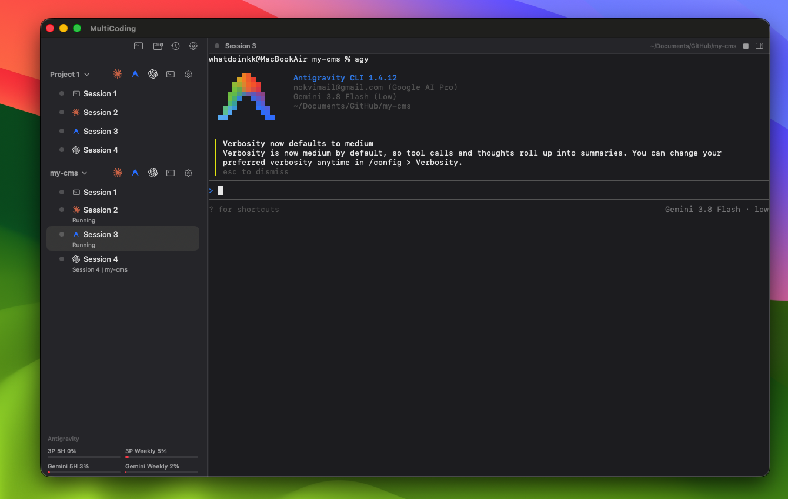

# MultiCoding

[Download the latest release](https://github.com/eaykutalp/multicoding/releases/latest) · [DMG](https://github.com/eaykutalp/multicoding/releases/latest/download/MultiCoding-0.8.7.dmg) · [ZIP](https://github.com/eaykutalp/multicoding/releases/latest/download/MultiCoding-0.8.7.zip)

**Claude Code, Codex and Antigravity sessions in one native macOS app.**

MultiCoding gives each project a sidebar of terminal sessions. See which agents are working or waiting, resume the same conversations, and manage parallel work from one place.



## What it does

- Runs Claude Code, Codex, Antigravity, custom commands and plain terminal sessions.
- Keeps each session's agent and conversation identity when project defaults change; resume or restart the same conversation. Session numbers stay unique within each project.
- Shows session activity, notifications, agent approvals and subagents where supported.
- Offers a project setting to skip permission prompts across Claude Code, Codex and Antigravity. Codex remote sessions resume with their configured permissions.
- Creates isolated Git worktrees for parallel tasks, with diffs, review notes and GitHub pull request status.
- Includes file preview, a local web preview, image/file attachments and recent conversations.
- Shows provider usage limits when available. No telemetry or automatic updater.

## Install or build

Download MultiCoding from this repository's Releases and move it to Applications. Or build locally (requires Xcode 26 / Swift 6.2 or later):

```sh
./build.sh
```

Supported on Apple Silicon and macOS 14+. Install the agent CLIs you want to use: `claude`, `codex`, or Google's Antigravity CLI (`agy`). A plain shell works without them. See [build instructions](docs/building.md).

## Keyboard shortcuts

| Action | Shortcut |
| --- | --- |
| New terminal / shell | ⌘T / ⇧⌘T |
| New project / worktree session | ⇧⌘N / ⌥⌘T |
| Open folder / recent conversations | ⌘O / ⇧⌘O |
| Close session / close window | ⌘W / ⇧⌘W |
| Rename / edit session | ⌘R / ⌘I |
| Restart / interrupt session | ⇧⌘R / ⇧⌘. |
| Start or continue session | ⇧⌘↩ |
| Jump to session | ⌘K |
| Previous / next session | ⇧⌘[ / ⇧⌘] |
| Select session 1–9 in project | ⌘1 … ⌘9 |
| Right panel / Files / Changes / Browser | ⌥⌘F / ⌥⌘1 / ⌥⌘2 / ⌥⌘3 |
| Increase / decrease / reset terminal font | ⌘+ / ⌘− / ⌘0 |

## Privacy

MultiCoding has no telemetry and does not check for or install updates. Integrations use each provider's own login; Codex management uses an authenticated local connection. See [privacy details](docs/privacy.md).

## Credits

Created by [Emre AYKUTALP](https://emreaykutalp.com). MultiCoding is independent and is not affiliated with Anthropic, Google or OpenAI. Licensed under [MIT](LICENSE).
